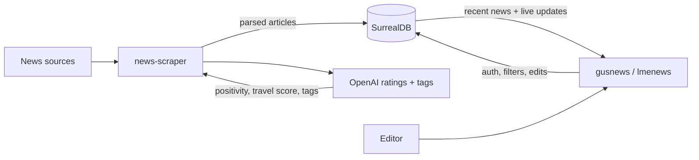

# gusnews

[](https://github.com/mirsella/gusnews/actions/workflows/nuxt.yml)
[](https://nuxt.com)
[](https://surrealdb.com)
[](LICENSE)

A Nuxt frontend for browsing, filtering, editing, and curating the news dataset collected by [`news-scraper`](https://github.com/mirsella/news-scraper). It connects directly to SurrealDB, loads recent articles, subscribes to live updates, and gives editors a table/card workflow for ratings, tags, notes, links, and used-state tracking.

One codebase builds two sites:

| `SITE` | Site | Default base path | Look |
| --- | --- | --- | --- |
| `gusnews` (default) | Gusnews | `/gusnews` | green, `rating` column |
| `lmenews` | Le Média Expérience | `/lmenews` | blue, LME logo, `rating_travel` column |

Site settings live in [`sites.ts`](sites.ts). Per-site public files (favicon) live in `public/<site>/`. `lmenews` used to be a separate repository; its history is merged here.

## Pipeline



## Quick start

```bash
pnpm install
pnpm dev                 # gusnews
SITE=lmenews pnpm dev    # lmenews
pnpm test
```

Requires Node.js 20+, pnpm, and a SurrealDB 4 database using the [`news-scraper`](https://github.com/mirsella/news-scraper) schema. In development the app also tries `http://localhost:8000`. It signs in to namespace `news`, database `news`, with record access method `user`.

SurrealDB endpoints are listed in `runtimeConfig.public.surrealdb_urls` in [`nuxt.config.ts`](nuxt.config.ts); the app uses the fastest one that answers.

## Build and deploy

`SITE` is read at build time. `BASE_URL` defaults to `/` for `pnpm build` and to `/<site>` in Docker.

```bash
SITE=lmenews BASE_URL=/lmenews pnpm build

docker build --build-arg SITE=lmenews -t lmenews .
make SITE=lmenews          # build and run the container
```

The container listens on port `3000` and runs `.output/server/index.mjs`.

## Production analytics

Runtime settings: `NUXT_PUBLIC_POSTHOG_KEY` (public `phc_` project token), `NUXT_PUBLIC_POSTHOG_HOST=https://eu.i.posthog.com`, and `NUXT_PUBLIC_POSTHOG_ENVIRONMENT=production`. Missing keys disable telemetry with a warning. Never put a personal PostHog API key in public configuration. Events are tagged `<site>-web` and `<site>-server`.

The client records anonymous pageviews, article link clicks, database/authentication state, and sanitized errors. Query strings, credentials, text autocapture, and session replay are excluded. Server request counts are separate from browser visits. Visit with `?telemetry_test=1` for validation; the traffic dashboard excludes these events. Browser blockers can prevent telemetry.

Count daily distinct browser IDs on `authenticated_visit` for logged-in activity. It fires after validated authentication, including restored JWTs, route changes, and visible focus/input on a new Paris calendar day. Idle tabs do not generate visits by timer. This counts active browsers, not distinct accounts.

[Production dashboard](https://eu.posthog.com/project/342382/dashboard/1099393).

## License

[MIT](LICENSE).
